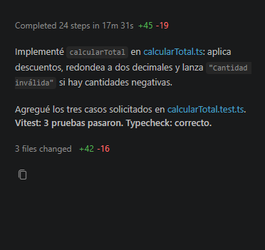

# Comparativa M1 · calcularTotal

## Herramientas usadas

- Herramienta A: ChatGPT (Codex).
- Herramienta B: GitHub Copilot.
- Editor: Visual Studio Code.
- Modo de trabajo: Agent.

El uso de Codex fue autorizado por el docente del curso.

## Metodología

Utilicé el mismo prompt para ambas herramientas, trabajando
en ramas independientes que parten del commit `24540c4`,
con la misma configuración de TypeScript y Vitest.

### Prompt utilizado

Creá la función calcularTotal(items) en web/src/carrito/calcularTotal.ts. Cada item tiene { precio: number; cantidad: number; descuento?: number }, donde descuento va de 0 a 1. Devolvé el total redondeado a 2 decimales. Si alguna cantidad es negativa, lanzá un Error con el mensaje "Cantidad inválida". Agregá tests con Vitest para: carrito vacío, un producto con descuento y cantidad negativa.

## Comparación

| Criterio | ChatGPT (Codex) | GitHub Copilot |
|---|---|---|
| Tiempo hasta una versión aceptable | No registrado completamente | No registrado completamente |
| Tiempo registrado del agente | 2 min 13 s de verificación | 17 min 31 s de trabajo |
| Correcciones manuales iniciales | 0 | 0 |
| Tests aprobados | 3 de 3 | 3 de 3 |
| Duración de Vitest | 207 ms | 154 ms |
| Errores de TypeScript | 0 | 0 |
| Fidelidad observable a AGENTS.md | Buena | Buena |
| Lectura de AGENTS.md | No confirmada | Confirmada |
| Método utilizado | reduce() | for...of |
| Prueba específica de redondeo | Sí | No |
| Dependencias adicionales | Ninguna | Ninguna |
| Validación de descuentos inválidos | No | No |

Los tiempos de los agentes no son directamente comparables,
porque el tiempo registrado de Codex corresponde a una
verificación de código existente, mientras que el de Copilot
incluye la implementación y la resolución de problemas del entorno.

La duración de Vitest tampoco permite afirmar que una
implementación es más eficiente, porque solamente se realizó
una medición por herramienta.

## Evidencias

### ChatGPT (Codex)

- [Rama feature/chatgpt](https://github.com/EquiverN/Feria-Andina/tree/feature/chatgpt)
- Commit de referencia: `57795b9`.

Resultado de la terminal:

    Test Files  1 passed (1)
    Tests       3 passed (3)
    Duration    207ms

La verificación de TypeScript mediante `tsc --noEmit`
finalizó sin errores.

### GitHub Copilot

- [Rama feature/copilot](https://github.com/EquiverN/Feria-Andina/tree/feature/copilot)
- Commit de referencia: `0d1e8f1`.

Resultado de la terminal:

    Test Files  1 passed (1)
    Tests       3 passed (3)
    Duration    154ms

La verificación de TypeScript también finalizó sin errores.

Durante la ejecución de las pruebas, Copilot encontró
una restricción de seguridad de PowerShell que impedía
ejecutar npm.ps1.

El agente utilizó npm.cmd como alternativa, sin necesidad
de modificar las políticas de seguridad de Windows.

## Qué acepté, qué corregí y por qué

De ambas herramientas acepté:

- La interfaz ItemCarrito.
- El uso de TypeScript sin el tipo any.
- La validación de cantidades negativas.
- El descuento opcional con valor predeterminado de cero.
- El redondeo mediante Math.round y Number.EPSILON.

Codex utilizó reduce() para recorrer los productos,
mientras que Copilot utilizó un bucle for...of.

Elegí el bucle for...of de Copilot para la implementación
definitiva porque me resulta más sencillo de comprender
y mantener.

De Codex incorporé la prueba que verifica el redondeo
a dos decimales, ya que Copilot solamente comprobaba
el descuento con un resultado entero.

Durante la revisión identifiqué que ninguna de las dos
herramientas validaba los descuentos fuera del rango
permitido.

Con asistencia de ChatGPT, incorporé una validación
adicional y amplié las pruebas automatizadas.

Conservé las implementaciones originales en sus ramas
y guardé la versión corregida en main.

## Un caso borde que el prompt no contemplaba

El prompt indicaba que el descuento debía estar entre
0 y 1, pero no especificaba qué hacer cuando se recibía
un valor fuera de ese rango.

Por ejemplo:

    precio: 100
    cantidad: 1
    descuento: 1.5

Ambas implementaciones originales devolverían -50,
un resultado incorrecto para este carrito de compras.

Para solucionar el problema, incorporé esta validación:

    const descuento = item.descuento ?? 0;

    if (!Number.isFinite(descuento) ||
        descuento < 0 || descuento > 1) {
      throw new Error("Descuento inválido");
    }

También agregué seis pruebas adicionales:

- Redondeo a dos decimales.
- Productos sin descuento.
- Descuento del 100%.
- Descuentos superiores a 1.
- Descuentos negativos.
- Descuentos no finitos.

### Resultado de la implementación definitiva

    Test Files  1 passed (1)
    Tests       9 passed (9)
    Duration    153ms

La verificación de TypeScript finalizó sin errores.

Commits de las mejoras:

- `634112f`: fix: validar descuentos invalidos.
- `8d05d99`: test: ampliar cobertura de casos borde.

## Para qué tarea usaría cada herramienta

### ChatGPT (Codex)

Lo utilizaría para:

- Comprender código y conceptos de programación.
- Analizar y solucionar errores.
- Revisar implementaciones.
- Generar pruebas adicionales.
- Mejorar código existente.

### GitHub Copilot

Lo utilizaría para:

- Autocompletar código durante el desarrollo.
- Implementar funcionalidades dentro del editor.
- Explorar archivos del proyecto.
- Ejecutar pruebas y resolver problemas del entorno.

Considero que ambas herramientas pueden complementarse.
La elección depende de la tarea, la claridad del código
y la calidad de los resultados.

## Reflexión personal

### ¿Qué regla de AGENTS.md cambió más la respuesta de la IA?

Considero que las reglas de TypeScript estricto y el uso
de nombres descriptivos en español fueron importantes
para mantener la coherencia del código.

Ambas herramientas respetaron estas convenciones,
aunque no realicé una prueba sin AGENTS.md para medir
su influencia de manera independiente.

### ¿En qué momento sentí que la herramienta tomaba decisiones por mí?

Cuando cada herramienta eligió un método diferente
para recorrer los productos y ambas incorporaron
Number.EPSILON para mejorar el redondeo.

Estas decisiones no estaban detalladas en el prompt,
por lo que fue necesario comprenderlas y evaluarlas.

### ¿Qué haría distinto si la tarea fuera diez veces más grande?

- Dividiría la funcionalidad en tareas pequeñas.
- Solicitaría un plan antes de modificar el código.
- Revisaría cada cambio mediante git diff.
- Ejecutaría pruebas después de cada modificación.
- Realizaría commits pequeños y descriptivos.
- Evitaría aceptar grandes cantidades de código sin revisarlas.

## Conclusión

Esta actividad me permitió comprender la importancia
del AI Pair Programming.

Ambas herramientas generaron soluciones que aprobaron
las pruebas originales, pero la revisión crítica permitió
detectar un caso borde y mejorar la implementación,
pasando de tres a nueve pruebas aprobadas.

La inteligencia artificial facilita el desarrollo,
pero el desarrollador sigue siendo responsable de
comprender, revisar y validar el código antes de aceptarlo.
